<!-- gráfico de contribuições animado: dados reais, as caixinhas aparecem uma a uma
     (atualizado todo dia por .github/workflows/update-profile-art.yml) -->

<h3><code>miguel@creativezone ~ $ ./contributions.sh</code></h3>

 
 

<!-- retrato em ASCII (esquerda) + card de sequência e números (direita). os dois svgs
     têm 840x880, então larguras iguais dão alturas iguais.
     retrato: python scripts/make_ascii_svg.py assets/photo.png
     números: python scripts/update_profile_art.py (mesmo workflow diário) -->

<h3><code>miguel@creativezone ~ $ whoami</code></h3>

<table>
<tr>
<td valign="top"></td>
<td valign="top"></td>
</tr>
</table>

 
 

<h3><code>miguel@creativezone ~ $ ./links.sh</code></h3>

<b>Desenvolvimento · Design · Criatividade</b>

 

